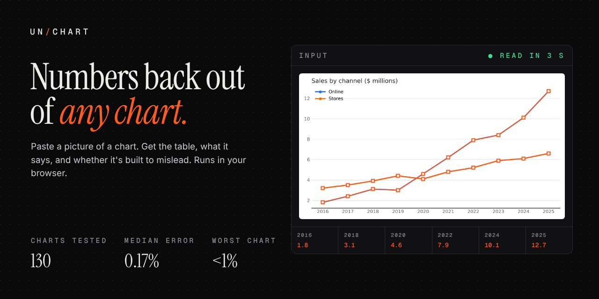
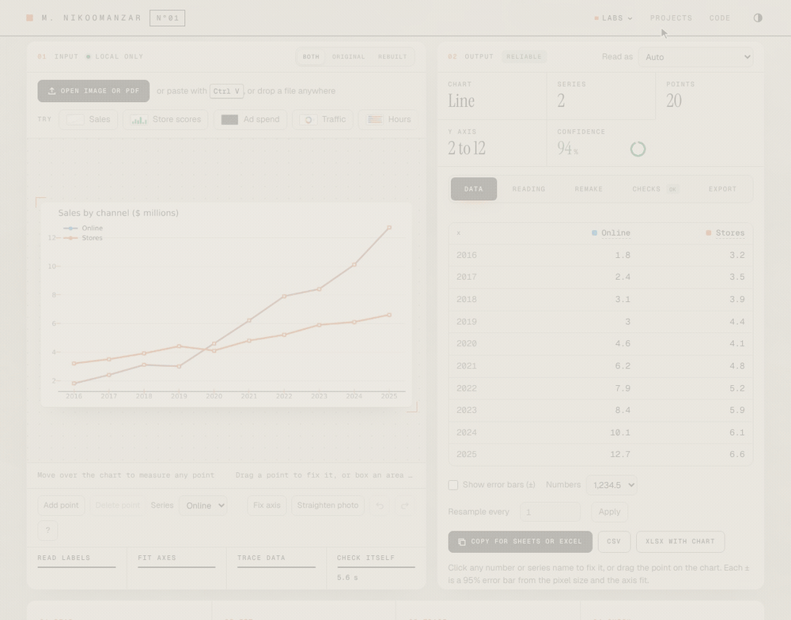
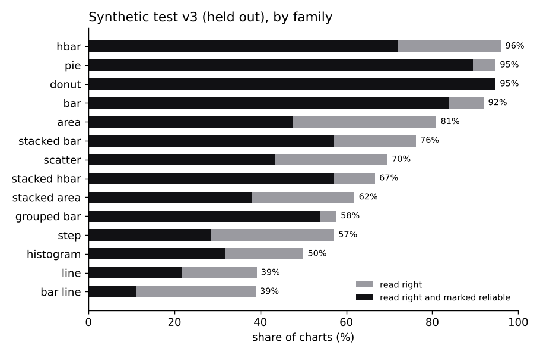
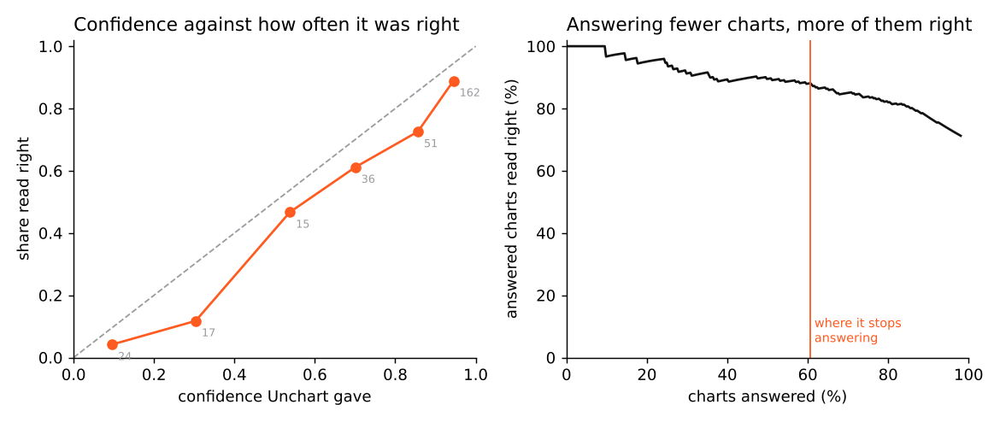

# Unchart

Paste a picture of a chart and get the numbers back.



I kept retyping numbers off charts in PDFs and slides, so I built this. It reads the axis labels, fits the scale, traces the lines, bars, slices and dots, and gives you a table you can paste into Sheets or Excel. Every number comes with an error bar, and when it isn't sure about a chart it says so and tells you why. Then you can redraw the chart the way you want it and download it. Everything runs in the browser and nothing gets uploaded.



Here it reads a bar chart, flags that the axis does not start at zero, and then I switch it to horizontal bars and pick a new look.

Try it at [matinnikoo.github.io/unchart](https://matinnikoo.github.io/unchart/)

## Results in short

It works on some charts and refuses a lot of others. On charts it was never tuned on it reads 69.8% of the synthetic ones right, 40.0% of the Our World in Data ones and 56.9% of the FRED ones.

I aimed for at most 2% of charts coming back wrong while marked reliable. I set the confidence cut for that on dev charts, where it held. On the held out synthetic sets it came out at 3.4% (test v2) and 7.5% (test v3), so on charts it has not seen it trusts itself more than I meant it to.

This is the version in this repo, which reads with the rules alone. The held out charts are 618 in all. They are 318 synthetic charts (test set v3, 14 chart types, 13 of them with the axis numbers hidden on purpose, which no reader can do anything with, so rates are over the other 305), 112 charts of 8 newer types, 130 Our World in Data charts and 58 FRED charts. Intervals in brackets are Wilson 95% intervals.

| Held out set | Charts | Read right | Success | Refused | Silent wrong |
|---|---|---|---|---|---|
| Synthetic, 14 chart types | 318 (305 readable) | 69.8% (64.5 to 74.7) | 52.5% (46.9 to 58.0) | 39.3% (34.0 to 44.9) | 7.5% (5.1 to 11.1) |
| 8 newer chart types | 112 | 64.3% (55.1 to 72.6) | 44.6% (35.8 to 53.9) | 50.9% (41.8 to 60.0) | 4.5% (1.9 to 10.0) |
| Our World in Data | 130 | 40.0% (32.0 to 48.6) | 14.6% (9.6 to 21.7) | 80.8% (73.2 to 86.6) | 4.6% (2.1 to 9.7) |
| FRED | 58 | 56.9% (44.1 to 68.8) | 34.5% (23.6 to 47.3) | 58.6% (45.8 to 70.4) | 1.7% (0.3 to 9.1) |

Read right means the chart type, the number of series and points and the values all came out right, with the average error at most 2% of the axis range. Success is read right and marked reliable. Refused means it returned no numbers or said it is not sure. Silent wrong means it marked the chart reliable and was wrong anyway.

It refuses a lot. It refused 39.3% of the synthetic charts and 58.6% of the FRED charts, and on Our World in Data it refused 80.8%, so only 14.6% of those charts came out right and marked reliable. The charts it does answer are mostly right. Of the charts it did not refuse, 86% of the synthetic ones, 76% of the Our World in Data ones and 83% of the FRED ones were read right. The intervals are wide, about 10 points on the synthetic set, 17 on Our World in Data and 25 on FRED, so most differences between engine versions on the real sets are inside the noise. [`results/intervals.md`](results/intervals.md) has every interval, made by `bench/intervals.py`.

### How clean these numbers are

The synthetic sets were redrawn from new seeds for each round (test v1, v2 and v3, with looks that no earlier set used). Our World in Data test and FRED could not be redrawn, so engine v1, v2 and v4 were each scored on the same 188 real charts, with the reader changed in between. I worked on dev charts only and did not open the failures on those two sets, but they are not fresh test sets after the first round. Test v1 was not fully unseen either, because I looked at 9 of its images once to check a bug in my chart generator.

I turned the mark model off after seeing the test v3 replays of both settings, so the numbers above are a choice made with test data in view. The mark model run was the one I froze and scored first. Its numbers are in the table below.

| Held out set | Charts | Read right | Success | Refused | Silent wrong |
|---|---|---|---|---|---|
| Synthetic, 14 chart types | 318 (305 readable) | 69.8% (64.5 to 74.7) | 42.0% (36.6 to 47.6) | 51.8% (46.2 to 57.4) | 5.6% (3.5 to 8.7) |
| 8 newer chart types | 112 | 61.6% (52.4 to 70.1) | 38.4% (29.9 to 47.6) | 60.7% (51.5 to 69.3) | 0.9% (0.2 to 4.9) |
| Our World in Data | 130 | 37.7% (29.8 to 46.3) | 11.5% (7.1 to 18.2) | 85.4% (78.3 to 90.4) | 3.1% (1.2 to 7.6) |
| FRED | 58 | 56.9% (44.1 to 68.8) | 29.3% (19.2 to 42.0) | 63.8% (50.9 to 74.9) | 1.7% (0.3 to 9.1) |

Read right is the same or a little lower with the model. The default accepts more charts as reliable, so it succeeds on more of them and is silent wrong on more (7.5% against 5.6% on synthetic, 4.5% against 0.9% on the newer types). I fit its confidence on dev reads without the model, and that cut kept silent errors at 1.7% on dev. The model costs 1.7 to 2.3 seconds per chart and a 3.1 MB download for no gain on test, which is why it is an experimental switch ("Use the experimental mark model" in the app, `--mark-model` on the command line, with its own calibration in `src/calibration_model.json`).

Earlier rounds, on the same kind of held out sets.

| Held out set | Engine | Charts | Read right | Silent wrong |
|---|---|---|---|---|
| Synthetic, 14 chart types | v1 | 543, 5 excluded by bad_render | 61.0% | 5.1% |
| Synthetic, 14 chart types | v2 | 545, 3 excluded by bad_render | 62.7% | 3.4% |
| Synthetic, 14 chart types | v4 | 318 | 69.8% | 7.5% |
| 8 newer chart types | v2 | 112 | 51.8% | 2.7% |
| 8 newer chart types | v4 | 112 | 64.3% | 4.5% |
| Our World in Data | v1 | 130 | 33.1% | 3.8% |
| Our World in Data | v2 | 130 | 30.8% | 3.1% |
| Our World in Data | v4 | 130 | 40.0% | 4.6% |
| FRED | v1 | 58 | 46.6% | 0.0% |
| FRED | v2 | 58 | 55.2% | 0.0% |
| FRED | v4 | 58 | 56.9% | 1.7% |

Test v3 is a different and in some ways harder set than v2 (a third of its charts use a random palette), so these rows are not a clean before and after. Replaying the same test v3 OCR words through engine v3 gives 68.5% on synthetic, against 69.8% for v4. That is four charts out of 305 and well inside the noise. The gain on Our World in Data (31.5% with engine v3, 40.0% with v4, replayed on the same words) is the one that looks real, and I put it down to rule fixes for yearly data. The mark model helped on dev (74.4% against 72.9% of 480 dev charts) and is a wash on test. [`results/v4/dev_progress.md`](results/v4/dev_progress.md) has the whole story, and [`docs/benchmark.md`](docs/benchmark.md) the protocol, the exact sets and everything I looked at.

On clean pictures the default reads 75 of 95 test v3 synthetic charts right. Most of what is left is damage. Scans (14 of 30), JPEG (17 of 32), downscaling and blur make the tick labels unreadable long before the lines and bars are, and without the labels there is no scale.



The full tables for v2, by chart type, tool, damage, picture size, axis format and number of series, are in [`results/tables.md`](results/tables.md). The v1 run is kept as it was in [`results/v1`](results/v1) and the v4 runs are in [`results/v4`](results/v4) (`test_summary.json` and a scored file per set).

## What it does

- Reads bars (vertical, horizontal, grouped, stacked), lines (dashed, with markers, on number, date or category axes), step lines, areas, stacked areas, scatter plots, pies, donuts, histograms and bars with a line. It also reads waterfalls, lollipops, bubble charts (the bubble centers), dot plots, slope charts, 100% stacked bars and bars with error bars, though some of those much better than others (see below). You can override the type.
- Handles log axes, negative values, thousands separators, currency, percent, K/M/B, European decimals and dates, plus dark backgrounds, legends inside the plot, blur, JPEG, noise and slight rotation. Excel, Google Sheets and slide deck looks are part of the benchmark.
- Paste, drop or pick an image or a PDF. In a PDF it finds every chart on every page, and an image with several charts gives you a chip per chart. A phone photo of a screen can be straightened by dragging four corners.
- Lets you fix anything by hand. Drag, add or delete points with a magnifier under the pointer, move a point to another series, rename series, click two ticks and type their values to set the axis yourself, undo and redo, all from the keyboard too.
- Exports to CSV, TSV, XLSX, JSON, Markdown, LaTeX, pandas or R, or copies for Sheets. The XLSX has real dates, a frozen header and a native Excel chart of the data that you can restyle in Excel or Sheets. You can also resample a line onto an even grid and get summary stats per series.
- Redraws the chart in an editor with the controls of a spreadsheet's Format pane. Switch between 16 chart types and click any element in the picture to format it. Fills (solid, gradient, pattern), outlines and dashes, shadow, glow and soft edges, rounded corners, bar gap and overlap, marker shapes, smoothing, data label position and number format, axis range, units, log, crossing and tick marks, fonts (or any installed font), and the chart and plot area. Per bar, per point and per series colors, text boxes, shapes, arrows, callouts, reference lines and bands. 14 looks and a set of quick layouts drawn live from your data, saved themes you can export, copy and paste format, undo and redo, keyboard shortcuts and a full screen mode. A check for colors that look alike to color blind readers and for faint text, and alt text. Export PNG at 1x, 2x or 4x, SVG, PDF, or copy the image, and the XLSX chart follows the editor. See [`docs/editor.md`](docs/editor.md).
- Checks for charts drawn to mislead (bars that skip zero, log scales, zoomed axes, two y axes, uneven time steps, crowded pies) and can redraw them with a fair axis. See the next section.
- Writes a plain text description of the chart you can use as alt text.

### Charts drawn to mislead

The check for bars that skip zero flagged all 10 of the 10 bar charts that skip zero in the old v1 set and none of the 10 that start at zero. That is a small sample from the first version of the benchmark. On the held out synthetic sets every bar chart starts at zero, so any flag there is a false one, and it fired on 6 of 146 bar charts in test v2 and 2 of 88 in test v3. I have no sample of the other checks (log scales, zoomed axes, two y axes), so I can't say how often they are right. The numbers are in [`results/misleading.json`](results/misleading.json).

### The newer chart types

These were added late, drawn with matplotlib and the Excel, Sheets and slide looks, and have their own dev and test sets of 112 charts each. On the test v3 set the default read right bars with error bars 14 of 14 times, waterfalls 13 of 14, lollipops 12 of 14, 100% stacked bars 9 of 14, slope charts 8 of 14, bubble charts 6 of 14, dot plots 5 of 14 and lines on two y axes 5 of 14, though all 14 of those were refused. Unless the tick labels are colored like their line I can't tell which line belongs to which axis, and guessing would be a confident wrong answer half the time. Box plots, radar charts and area range bands are not read at all.

## Compared with DePlot

DePlot (Google's chart to table model, `google/deplot` on Hugging Face) on the same charts, run on my laptop's CPU. DePlot does not say what kind of chart it saw, so this compares the values only, with the chart type left out for both tools. The Unchart rows are the shipped default, rerun on exactly these charts.

| Charts | Tool | Read right | Median error | Time per chart |
|---|---|---|---|---|
| 27 from synthetic test v1 | Unchart v4 | 23 of 27 | 0.18% | 2.3 s |
|  | DePlot | 4 of 27 | 15.20% | 93.8 s |
| 5 from FRED | Unchart v4 | 3 of 5 | 0.88% | 3.9 s |
|  | DePlot | 0 of 5 | 11.70% | 330.3 s |

On the 27 synthetic charts Unchart read 23 right and DePlot 4. On the 5 FRED charts it is 3 against 0, and Fisher's exact test gives p = 0.17, which is not significant. Five charts say very little. The synthetic gap is large (p below 0.001), but the 27 charts are an easier subset. Engine v1 read 70% of them right and 62% of all 526 readable charts in that set. I stopped the Our World in Data run after two charts, because DePlot takes minutes per chart on a CPU. DePlot reads the gist of a chart well and often gets the labels right, but its numbers are rounded guesses. I did not compare against a non neural baseline such as a plain axis fit with color grouping, so I can't say how much of the gap comes from being a neural model. The scripts are `bench/deplot.py` and `bench/vs_deplot.py` and the output is in [`results/vs_deplot.md`](results/vs_deplot.md).

## How it works

Normal OCR struggles with tick labels, so Unchart finds the small glyphs itself, puts them all on one clean sheet and reads them in one pass with tesseract.js, and a second reader (the PP-OCRv5 recognizer, run with onnxruntime) reads every number label again. Where the two disagree, the reading that lines up with the other labels wins. The axis is a line fit that ignores misread labels, and the common OCR slips on tick labels (a lost minus sign, a dropped decimal point, powers of ten) are fixed only when another label proves it. Colors in the plot become series, lines are traced and snapped to the data's x grid, bars are measured to a fraction of a pixel and pie slices are read from their angles. An optional small U-Net (773K parameters, trained on 22,000 charts I drew with a label on every pixel, off by default) marks which pixels are series, text or gridlines and which series pixels belong together.

Then it checks itself. It reads every chart a second time on a smaller copy with slightly different settings and looks at about thirty signals like how well the labels lined up, whether more corners were drawn than points found and whether two reads agree. A small model fit only on the dev charts turns those into a confidence. I set the cut with cross validation on dev so that at most 2% of dev charts would come back wrong but marked reliable, then froze everything and ran the test sets. The test charts turned out harder for it than dev in ways the confidence does not fully see (see the top of this page). [`docs/method.md`](docs/method.md) has the details.

A chart takes a median of 3.2 seconds in headless Chromium on two CPU cores (2.3 on synthetic charts, 4.7 on Our World in Data and 3.0 on FRED), most of it OCR. [`results/timing.json`](results/timing.json) has the 90th percentile.



## Use it from code

The batch tool reads a folder of images or PDFs and writes a CSV per chart plus `results.json`, using the same reader in headless Chromium.

```bash
npm install
node bin/unchart.js report.pdf screenshots/ --out unchart-out
```

From Node it looks like this.

```js
const { readFiles, toCSV } = require('./lib/unchart.js');
const results = await readFiles(['report.pdf']);   // one result per chart: type, series, confidence, reliable, issues
```

In a page, load `src/engine.js` and `src/ocr.js` and call `UnchartOCR.readChart(canvas, paths)`, or call `Unchart.extract(imageData, words)` with your own OCR words. `src/export.js` turns a table into any of the export formats (`UnchartExport.xlsx(table, { chart: { type: 'line' } })` for a workbook with a chart) and `src/remake.js` draws a table as SVG (`UnchartRemake.render(table, spec).svg`, where the spec is what the editor saves with Save chart settings).

## Rerun everything

```bash
npm ci && npx playwright install chromium && pip install -r requirements.txt
npm test              # engine and export unit tests
npm run test:ui       # the app and the chart editor end to end in Chromium, screenshots in test/shots
python3 bench/get_dataset.py   # the full benchmark charts, see below
npm run bench:fred    # fetch the FRED charts (not redistributed, see below)
npm run bench         # every set through the app's pipeline in Chromium, scored, tables and figures
```

The mark model retrains from scratch on CPU (about six hours on two cores) with the commands in [`bench/seg/README.md`](bench/seg/README.md).

The repo holds the truth file, the manifest and ten sample pictures for each benchmark set in `dataset/`, with a dataset card. The full sets are zips on the GitHub release `dataset-v1` (each under 24 MB, 175 MB in all), and `python3 bench/get_dataset.py` downloads them, checks their sha256 against `dataset/release.json` and unpacks them. The same release has `results_extra.zip` with the intermediate runs behind the numbers, such as the node replays and the calibration rounds. FRED's terms don't allow sharing its graphs, so `bench/real/fetch_fred.py` downloads them fresh. Our World in Data charts are CC BY 4.0.

## The first benchmark

The first version of this README reported 130 charts from matplotlib and Chart.js. They are still in `charts/`, `charts2/` and `charts3/` (a few sample pictures there, the rest in the release and unpacked by `bench/get_dataset.py`), with the scripts that drew them in [`legacy/`](legacy/). They were too easy to tell me much, which is why I built the bigger benchmark.

## Limits

- Damaged pictures are the biggest gap. On synthetic test v3 clean charts are read right 79.0% of the time, scans 46.7%, JPEG 53.1% and downscaled ones 71.4%.
- Colors it has not seen hurt. Charts with a random palette, sometimes with two close shades, read right 62.5% of the time on test v3 against 73.6% for the usual palettes.
- Lines with many overlapping series are weak. On Our World in Data line charts 51.2% come out right, and their stacked areas almost never do (1 of 17).
- Bars with a line (38.9%) and line charts (39.1%) were the worst synthetic families on test v3, far below dev.
- The mark model finds series pixels well (IoU 0.945 on held out training charts) but groups them into series poorly, so it mostly serves as a second opinion.
- It needs the axis numbers. With no numbers on the axis it refuses, unless every bar has its value printed on it.
- Error bars cover 84.5% of true values on synthetic test v3 and 61.7% on Our World in Data, but only 33.5% on FRED, where long dense lines are traced between data points.
- Tick labels that OCR misreads in the same way on every label (all decimal points dropped) can't be caught.
- It does not check 3D effects or pictures sized by area, and it does not read box plots, radar charts or bands.
- The test results are from frozen runs. While scoring test v2 the scorer crashed on one chart whose renderer did not report the top of its axis, so the scorer now falls back to the data range there. For v4 a bug that refused every pie showed up on dev while the test runs were going, so I stopped them unscored, fixed it and froze again before any test score (`results/v4/freeze.txt`). After the scores I fixed two more bugs in the shipped tree (a pie's legend split into a second chart, and one warning listed twice) and replayed all four held out sets to check that no read changed. `docs/benchmark.md` lists these and the test reuse in full.

## License

The code is MIT (see `LICENSE`). The third party parts below keep their own licenses, and `NOTICE` lists them with versions and file locations.

- PP-OCRv5 English recognizer (`vendor/pp/`) is by the PaddlePaddle team at Baidu (PaddleOCR) under Apache 2.0. I did not convert it myself. The ONNX file is from the Hugging Face repo [monkt/paddleocr-onnx](https://huggingface.co/monkt/paddleocr-onnx), which says it was converted with paddle2onnx and lists Apache 2.0.
- onnxruntime-web 1.22.0 (`vendor/ort/`) is by Microsoft under the MIT license.
- tesseract.js 5.1.1, tesseract.js-core (the WebAssembly build of Tesseract) and the English `tessdata_best` language data are Apache 2.0. The bundled `vendor/worker.min.js` has a one line fix for a tesseract.js 5.1.1 bug when the language data is passed in directly.
- pdf.js 3.11.174 (`vendor/pdf.min.js`) is by Mozilla under Apache 2.0.
- The mark model (`vendor/seg/unchart_marks.onnx`) is mine and MIT.
- The Our World in Data charts in `dataset/real-owid` are CC BY 4.0 by Our World in Data (https://ourworldindata.org). The data in them comes from the sources named in each chart's entry in `truth.json`, and those sources can carry their own terms, so check them before you reuse a chart or its numbers.
- FRED graphs are not included. They are by FRED, Federal Reserve Bank of St. Louis.
